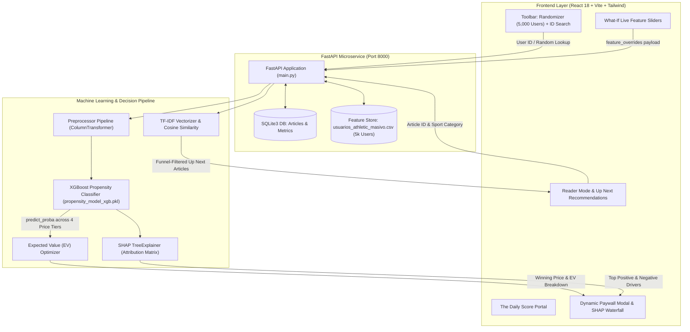
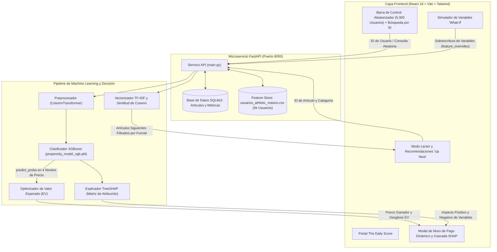

# ⚡ The Athletic — Dynamic Pricing & Retention ML Platform
### Microeconomic Expected Value Optimization & Hybrid NLP Recommendation Engine
*Plataforma de Optimización de Precios Dinámicos por Valor Esperado y Motor Híbrido de Recomendación NLP*

---

[](https://www.python.org/)
[](https://fastapi.tiangolo.com/)
[](https://xgboost.ai/)
[](https://github.com/shap/shap)
[](https://react.dev/)
[](https://vitejs.dev/)
[](https://tailwindcss.com/)
[](https://opensource.org/licenses/MIT)

---

## 🌐 Language Navigation / Navegación de Idioma
- [🇬🇧 English Documentation](#-english-version)
  - [1. Executive Summary](#1-executive-summary)
  - [2. System Architecture](#2-system-architecture)
  - [3. Mathematical Formulations](#3-mathematical-formulations)
  - [4. Real-Time What-If Feature Simulator](#4-real-time-what-if-feature-simulator)
  - [5. Quickstart & Local Installation](#5-quickstart--local-installation)
  - [6. Repository Structure](#6-repository-structure)
- [🇪🇸 Documentación en Español](#-versión-en-español)
  - [1. Resumen Ejecutivo](#1-resumen-ejecutivo)
  - [2. Arquitectura del Sistema](#2-arquitectura-del-sistema)
  - [3. Fundamentos Matemáticos](#3-fundamentos-matemáticos)
  - [4. Simulador Interactivo "What-If"](#4-simulador-interactivo-what-if)
  - [5. Guía de Instalación Local](#5-guía-de-instalación-local)
  - [6. Estructura del Repositorio](#6-estructura-del-repositorio)

---

# 🇬🇧 English Version

## 1. Executive Summary

Digital sports media platforms face a dual monetization challenge:
1. **Problem A (Conversion via Dynamic Subscription Pricing):** Static paywalls and fixed-price subscriptions alienate price-sensitive readers while leaving revenue on the table with high-affinity fans.
2. **Problem B (Retention & Funnel Orchestration):** Premature paywalls on cold visitors drive high churn and bounce rates, whereas high-propensity readers should be guided toward premium offerings.

This platform implements an end-to-end Machine Learning and Microeconomic Optimization engine inspired by **The Athletic's Data Science challenges**:

- **Dynamic Expected Value ($EV$) Optimization:** Rather than predicting binary churn, an **XGBoost Classifier** evaluates multiple price points ($1.99, $3.99, $5.99, $9.99) across 42 behavioral and macroeconomic user features. The system computes the expected revenue for each offer and serves the mathematically optimal price that maximizes long-term yield.
- **Explainable AI (TreeSHAP):** Every pricing decision is accompanied by real-time Shapley values, exposing the exact behavioral drivers (reading velocity, paywall encounters, discount sensitivity, author loyalty) influencing conversion.
- **Hybrid NLP Recommendation Engine & Funnel Orchestrator:** Combines TF-IDF and Cosine Similarity over an SQLite content repository with dynamic propensity routing:
  - **Retention Mode ($P < 25\%$):** Routes cold visitors to high-affinity free editorial pieces to build consumption habits and reading velocity.
  - **Monetization Mode ($P \ge 25\%$):** Triggers personalized dynamic paywalls on premium analysis articles.

---

## 2. System Architecture



---

## 3. Mathematical Formulations

### 3.1. Microeconomic Expected Value Optimization

Let $\mathcal{P} = \{1.99, 3.99, 5.99, 9.99\}$ represent the set of subscription price points (in USD). For an individual user characterized by feature vector $\mathbf{x} \in \mathbb{R}^d$, the probability of subscription conversion at price point $p \in \mathcal{P}$ is estimated by the calibrated XGBoost model:

$$P(\text{Conversion} \mid \mathbf{x}, p) = \sigma(f(\mathbf{x}, p))$$

The **Expected Revenue** $EV(\mathbf{x}, p)$ is defined as:

$$EV(\mathbf{x}, p) = P(\text{Conversion} \mid \mathbf{x}, p) \times p$$

The optimal price offer $p^*$ presented to the user is the microeconomic argmax:

$$p^* = \arg\max_{p \in \mathcal{P}} EV(\mathbf{x}, p)$$

| Price Point ($p$) | User Profile Archetype | Economic Rationale |
| :--- | :--- | :--- |
| **$1.99** (Weekly Pass) | High price sensitivity, low purchasing power | Recovers marginal revenue from high-elasticity users |
| **$3.99** (Monthly Promo) | Moderate engagement, promotion hunter | Balanced entry hurdle with lower friction |
| **$5.99** (Standard Annual) | Steady readership, regular sport affinity | Benchmark subscription offering |
| **$9.99** (VIP All-Access) | High author loyalty, high income index | Captures consumer surplus from power readers |

---

### 3.2. Local Interpretability via SHAP TreeExplainer

For any individual prediction $f(\mathbf{x})$, Shapley Additive exPlanations allocate credit to each of the $M$ transformed features:

$$f(\mathbf{x}) = \phi_0 + \sum_{j=1}^{M} \phi_j(\mathbf{x})$$

Where $\phi_0 = \mathbb{E}[f(\mathbf{X})]$ is the base value across the training population, and $\phi_j$ represents the marginal contribution of feature $j$. The top positive and negative drivers are dynamically surfaced in the user interface to ensure algorithmic transparency.

---

### 3.3. Hybrid NLP Content Orchestration & Retention Gate

Articles are represented in a TF-IDF vector space $\mathbb{R}^V$ calculated over n-grams $(1, 2)$:

$$\text{TF-IDF}(t, d, D) = \text{TF}(t, d) \times \log\left(\frac{1 + |D|}{1 + |\{d \in D : t \in d\}|}\right) + 1$$

Given article vector $\mathbf{a}_i$ and candidate article vector $\mathbf{a}_j$, semantic relevance is scored via Cosine Similarity:

$$\text{Sim}(\mathbf{a}_i, \mathbf{a}_j) = \frac{\mathbf{a}_i \cdot \mathbf{a}_j}{\|\mathbf{a}_i\|_2 \|\mathbf{a}_j\|_2}$$

The **Propensity Funnel Filter** enforces business logic dynamically:

$$\text{Filter}(\mathbf{a}_j) = \begin{cases} 
\mathbf{a}_j \in \text{Articles}_{\text{Free}} & \text{if } P(\text{Conversion}) < 0.25 \quad (\text{Retention Mode}) \\
\mathbf{a}_j \in \text{Articles}_{\text{All}} & \text{if } P(\text{Conversion}) \ge 0.25 \quad (\text{Conversion Mode})
\end{cases}$$

---

## 4. Real-Time What-If Feature Simulator

To provide empirical proof that prices are calculated live from raw features rather than hardcoded heuristics:
- **5,000 Live User Feature Store:** Any user ID from `USR_0` to `USR_4999` can be loaded or randomized instantly.
- **In-Memory Feature Overrides:** Dragging the sliders for `checkout_abandonment_count`, `distinct_authors_read`, `macro_purchasing_power_index`, `historical_discount_sensitivity`, and `paywall_hits_total` overwrites the user's DataFrame row in real-time, executing the complete 4-price XGBoost inference loop and dynamically shifting winning prices and SHAP drivers on the fly.

---

## 5. Quickstart & Local Installation

### Prerequisites
- **Python:** 3.10, 3.11, or 3.12
- **Node.js:** v18+ and `npm`

### 1. Clone the Repository
```bash
git clone https://github.com/your-username/the-athletic-ml-platform.git
cd the-athletic-ml-platform
```

### 2. Set Up Python Backend
```bash
# Create and activate virtual environment
python -m venv venv

# On Windows (PowerShell):
.\venv\Scripts\Activate.ps1
# On macOS / Linux:
source venv/bin/activate

# Install dependencies
pip install -r requirements.txt
```

### 3. Start the Backend Server
```bash
python main.py
```
*The FastAPI backend will initialize the SQLite database, train/load the XGBoost pipeline, and listen at `http://localhost:8000`.*
*Interactive API docs are available at `http://localhost:8000/docs`.*

### 4. Start the Frontend
Open a separate terminal window:
```bash
cd frontend
npm install
npm run dev
```
*The Vite development server will launch at `http://localhost:5173`.*

---

## 6. Repository Structure

```text
├── main.py                         # FastAPI microservice, SQLite DB, ML inference & SHAP endpoints
├── train_model.py                  # XGBoost pipeline training script with ColumnTransformer
├── generar_csv.py                  # Synthetic feature store generator (5,000 users, 42 features)
├── score_users.py                  # Batch scoring script generating the VIP marketing list
├── explain_why_shap.py             # CLI standalone TreeSHAP explainer script
├── usuarios_athletic_masivo.csv    # 5,000-user feature store dataset
├── vip_marketing_list.csv          # Prioritized CRM conversion ranking
├── propensity_model_xgb.pkl        # Serialized preprocessor + XGBoost pipeline
├── requirements.txt                # Python backend dependencies
├── .gitignore                      # Git exclusion rules
└── frontend/                       # React 18 + Vite frontend
    ├── src/
    │   ├── TheDailyScore.jsx       # Complete portal: Paywall modal, What-If simulator, Reader mode
    │   ├── App.jsx                 # Root React wrapper
    │   └── main.jsx                # DOM mount entrypoint
    ├── package.json                # Frontend dependencies (Lucide React, Tailwind, Vite)
    └── vite.config.js              # Vite configuration
```

---

# 🇪🇸 Versión en Español

## 1. Resumen Ejecutivo

Los medios deportivos digitales enfrentan un doble desafío de monetización:
1. **Problema A (Conversión mediante Precios Dinámicos):** Los muros de pago estáticos con precios fijos desincentivan a los lectores sensibles al precio, mientras dejan ingresos sin capturar en los usuarios más leales.
2. **Problema B (Retención y Orquestación de Funnel):** Imponer un muro de pago prematuro a un visitante frío dispara la tasa de rebote (*churn*), mientras que un usuario con alta propensión debe ser guiado de inmediato hacia la conversión.

Esta plataforma implementa un motor de Aprendizaje Automático y Optimización Microeconómica inspirado en los desafíos de **Data Science de The Athletic**:

- **Optimización de Precios por Valor Esperado ($EV$):** En lugar de predecir una conversión binaria fija, un clasificador **XGBoost** simula 4 puntos de precio ($1.99, $3.99, $5.99, $9.99) evaluando 42 variables de comportamiento y poder adquisitivo. El sistema calcula los ingresos esperados y presenta la oferta óptima que maximiza el rendimiento financiero.
- **Inteligencia Artificial Explicable (TreeSHAP):** Cada decisión de precio se acompaña de valores SHAP calculados en tiempo real, exponiendo las variables exactas (velocidad de lectura, historial de muros de pago, sensibilidad a descuentos, lealtad a autores) que impulsan la propensión.
- **Motor Híbrido de Recomendación NLP y Orquestador de Funnel:** Combina TF-IDF y Similitud de Coseno sobre un repositorio SQLite con lógica de enrutamiento basada en propensión:
  - **Modo Retención ($P < 25\%$):** Recomienda contenido editorial gratuito de alta afinidad para construir hábito de lectura antes de monetizar.
  - **Modo Monetización ($P \ge 25\%$):** Activa el muro de pago dinámico personalizado en artículos de análisis exclusivo.

---

## 2. Arquitectura del Sistema



---

## 3. Fundamentos Matemáticos

### 3.1. Optimización Microeconómica de Valor Esperado

Sea $\mathcal{P} = \{1.99, 3.99, 5.99, 9.99\}$ el conjunto de ofertas de suscripción. Para un usuario con vector de características $\mathbf{x} \in \mathbb{R}^d$, la probabilidad de suscripción para cada precio $p \in \mathcal{P}$ se estima con el modelo calibrado XGBoost:

$$P(\text{Conversión} \mid \mathbf{x}, p) = \sigma(f(\mathbf{x}, p))$$

El **Valor Esperado de Ingresos** $EV(\mathbf{x}, p)$ se define como:

$$EV(\mathbf{x}, p) = P(\text{Conversión} \mid \mathbf{x}, p) \times p$$

La oferta óptima $p^*$ seleccionada para el usuario corresponde al máximo microeconómico:

$$p^* = \arg\max_{p \in \mathcal{P}} EV(\mathbf{x}, p)$$

---

### 3.2. Explicabilidad Local mediante SHAP TreeExplainer

Para cualquier inferencia individual $f(\mathbf{x})$, el método de valores Shapley aditivos descompone el resultado en la suma de contribuciones de las $M$ variables transformadas:

$$f(\mathbf{x}) = \phi_0 + \sum_{j=1}^{M} \phi_j(\mathbf{x})$$

Donde $\phi_0$ representa el valor base esperado poblacional, y $\phi_j$ cuantifica el impacto positivo o negativo de la característica $j$ para el usuario en evaluación.

---

### 3.3. Recomendación Semántica NLP y Filtrado de Funnel

Los artículos se proyectan en un espacio vectorial TF-IDF con n-gramas $(1, 2)$:

$$\text{TF-IDF}(t, d, D) = \text{TF}(t, d) \times \log\left(\frac{1 + |D|}{1 + |\{d \in D : t \in d\}|}\right) + 1$$

La afinidad temática entre dos artículos $\mathbf{a}_i$ y $\mathbf{a}_j$ se calcula mediante la Similitud de Coseno:

$$\text{Sim}(\mathbf{a}_i, \mathbf{a}_j) = \frac{\mathbf{a}_i \cdot \mathbf{a}_j}{\|\mathbf{a}_i\|_2 \|\mathbf{a}_j\|_2}$$

El **Filtro de Funnel por Propensión** aplica la regla de negocio:

$$\text{Filtro}(\mathbf{a}_j) = \begin{cases} 
\mathbf{a}_j \in \text{Artículos}_{\text{Gratis}} & \text{si } P(\text{Conversión}) < 0.25 \quad (\text{Modo Retención}) \\
\mathbf{a}_j \in \text{Artículos}_{\text{Todos}} & \text{si } P(\text{Conversión}) \ge 0.25 \quad (\text{Modo Monetización})
\end{cases}$$

---

## 4. Simulador Interactivo "What-If"

Para demostrar que los precios son calculados dinámicamente y no preasignados:
- **Feature Store de 5.000 Usuarios:** Permite consultar cualquier usuario de `USR_0` a `USR_4999` o utilizar el botón de usuario aleatorio (`🎲`).
- **Sobrescritura en Memoria:** Los controles deslizables permiten alterar variables clave (`checkout_abandonment_count`, `distinct_authors_read`, `macro_purchasing_power_index`, `historical_discount_sensitivity`, `paywall_hits_total`), recalculando de forma instantánea el ciclo completo de inferencia en XGBoost, el valor esperado y los factores explicativos SHAP.

---

## 5. Guía de Instalación Local

### Requisitos Previos
- **Python:** 3.10, 3.11 o 3.12
- **Node.js:** v18+ y `npm`

### 1. Clonar el Repositorio
```bash
git clone https://github.com/tu-usuario/the-athletic-ml-platform.git
cd the-athletic-ml-platform
```

### 2. Configurar el Entorno Python
```bash
# Crear y activar entorno virtual
python -m venv venv

# En Windows (PowerShell):
.\venv\Scripts\Activate.ps1
# En macOS / Linux:
source venv/bin/activate

# Instalar dependencias
pip install -r requirements.txt
```

### 3. Iniciar el Backend
```bash
python main.py
```
*El servicio FastAPI inicializará la base de datos SQLite en memoria, cargará el pipeline XGBoost y responderá en `http://localhost:8000`.*
*Documentación interactiva disponible en `http://localhost:8000/docs`.*

### 4. Iniciar el Frontend
En otra ventana de terminal:
```bash
cd frontend
npm install
npm run dev
```
*El servidor Vite estará accesible en `http://localhost:5173`.*

---

## 6. Estructura del Repositorio

```text
├── main.py                         # Servicio FastAPI, base de datos SQLite, endpoints de inferencia y SHAP
├── train_model.py                  # Script de entrenamiento del pipeline XGBoost con ColumnTransformer
├── generar_csv.py                  # Generador del feature store sintético (5.000 usuarios, 42 variables)
├── score_users.py                  # Script de puntuación por lotes para lista de marketing VIP
├── explain_why_shap.py             # Script CLI de explicabilidad SHAP para análisis individual
├── usuarios_athletic_masivo.csv    # Dataset con 5.000 usuarios y métricas de comportamiento
├── vip_marketing_list.csv          # Ranking CRM de usuarios prioritarios para conversión
├── propensity_model_xgb.pkl        # Pipeline serializado (preprocesamiento + XGBoost)
├── requirements.txt                # Dependencias Python
├── .gitignore                      # Exclusiones de Git
└── frontend/                       # Frontend en React 18 + Vite
    ├── src/
    │   ├── TheDailyScore.jsx       # Interfaz completa: Muro de pago, simulador What-If y modo lector
    │   ├── App.jsx                 # Contenedor raíz
    │   └── main.jsx                # Punto de entrada
    ├── package.json                # Dependencias Node.js (Lucide, Tailwind, Vite)
    └── vite.config.js              # Configuración de Vite
```

---

## 📄 License / Licencia
Distributed under the MIT License. See `LICENSE` for more information.  
*Distribuido bajo la Licencia MIT.*
